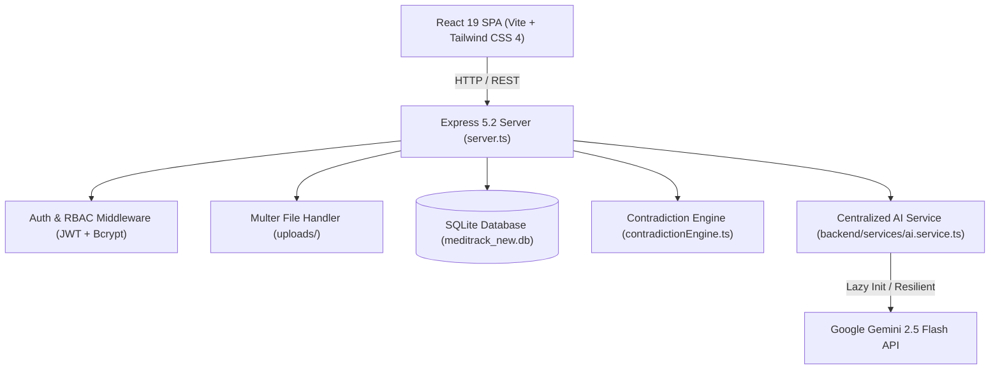

# MediTrack V3.1 — Intelligent Clinical Analytics & Longitudinal Healthcare Insights

[](https://www.typescriptlang.org/)
[](https://react.dev/)
[](https://tailwindcss.com/)
[](https://expressjs.com/)
[](https://ai.google.dev/)
[](https://sqlite.org/)
[]()

> **MediTrack V3.1** is a high-performance clinical analytics platform designed to ingest laboratory reports, extract biomarkers via Google Gemini AI, track longitudinal patient trends, detect diagnostic contradictions with clinical severity scoring, and provide proactive healthcare insights.

---

## 📑 Table of Contents

- [Key Features](#-key-features)
- [System Architecture](#-system-architecture)
- [Tech Stack](#-tech-stack)
- [Getting Started](#-getting-started)
  - [Prerequisites](#prerequisites)
  - [Installation](#installation)
  - [Environment Configuration](#environment-configuration)
  - [Running the Development Server](#running-the-development-server)
  - [Production Build & Execution](#production-build--execution)
- [Available NPM Scripts](#-available-npm-scripts)
- [Documentation Index](#-documentation-index)
- [Core API Endpoints](#-core-api-endpoints)
- [Clinical Contradiction Engine](#-clinical-contradiction-engine)
- [AI Service & OCR Integration](#-ai-service--ocr-integration)
- [Security & Compliance](#-security--compliance)
- [Quality Assurance & Validation](#-quality-assurance--validation)

---

## 🌟 Key Features

- **Automated Medical OCR & Structuring**: Instant biomarker extraction from PDF, JPG, and PNG clinical reports using Google Gemini 2.5 Flash with structured JSON schema outputs.
- **Fail-Fast Resilient AI Pipeline**: Centralized AI service with zero-crash lazy initialization, structured credential diagnostics, and graceful fallback handling (<100ms HTTP 503 if credentials unconfigured).
- **Clinical Contradiction Detection**: Multi-pass contradiction engine that compares biomarkers across longitudinal timelines with numeric normalization (`120` vs `120.0`), blood pressure parsing, and severity weighting (`CRITICAL`, `HIGH`, `MEDIUM`, `LOW`).
- **Interactive Longitudinal Analytics**: High-resolution biomarker trajectory visualization with baseline markers, healthy threshold bands, and statistical trend direction using Recharts and D3.
- **Risk Assessment & Future Outlook**: Automated predictive health risk scores and clinical specialty recommendation matching.
- **Interactive Geolocation Facility Search**: Integrated OpenStreetMap / Leaflet and optional Google Maps directory finding specialized hospitals and care centers within proximity.
- **Automated Validation Suite**: Built-in 14-point administrative software validation suite testing authentication, database queries, mathematical engines, and session lifecycle.
- **Executive PDF Export**: Print-ready clinical summary exports generated via jsPDF and HTML2Canvas.

---

## 🏗️ System Architecture



---

## 💻 Tech Stack

| Layer | Technologies |
| :--- | :--- |
| **Frontend Framework** | React 19, TypeScript, React Router DOM 7 |
| **Styling & Icons** | Tailwind CSS 4, Lucide React, Motion |
| **Data Visualization** | Recharts 3, D3 7 |
| **Mapping & Geospatial** | Leaflet 1.9, @vis.gl/react-google-maps |
| **Backend & Routing** | Node.js (v20+), Express 5.2, tsx, esbuild |
| **Database** | SQLite, @libsql/client |
| **Authentication** | JSON Web Tokens (`jsonwebtoken`), Bcrypt (`bcryptjs`), HTTP-only Cookies |
| **AI & Document OCR** | Google GenAI SDK (`@google/genai`), Gemini 2.5 Flash |
| **Document Generation** | jsPDF, jspdf-autotable, html-to-image |

---

## 🚀 Getting Started

### Prerequisites

- **Node.js**: v20.x or later installed
- **npm**: v10.x or later (or `bun` / `pnpm`)

### Installation

Clone the repository and install project dependencies:

```bash
git clone <repository-url>
cd "Meditrack V3.1"
npm install
```

### Environment Configuration

Meditrack V3.1 ships with safe local development defaults. Ensure a `.env` file exists in the workspace root. If missing, copy it from `.env.example`:

```bash
cp .env.example .env
```

Key environment configuration variables:

```ini
# Application Configuration
PORT=3000
NODE_ENV=development
APP_URL=http://localhost:3000

# Security (Change in production!)
JWT_SECRET=meditrack-dev-secret-key-replace-in-production-min32chars
JWT_REFRESH_SECRET=meditrack-dev-refresh-secret-replace-in-production-min32chars
SESSION_SECRET=meditrack-dev-session-secret-key

# Database
DATABASE_URL=file:./meditrack_new.db

# Optional AI Document Processing (Google AI Studio)
GEMINI_API_KEY=your_gemini_api_key_here
GEMINI_MODEL=gemini-2.5-flash

# Optional Geolocation Map Service
GOOGLE_MAPS_API_KEY=
VITE_GOOGLE_MAPS_API_KEY=
```

> **Note**: Even if `GEMINI_API_KEY` is not provided initially, the entire application boots and operates smoothly. Diagnostic endpoints gracefully report `NOT_CONFIGURED` without crashing or throwing warnings.

### Running the Development Server

Start the full-stack development server (Express backend + Vite client integrated):

```bash
npm run dev
```

Visit **`http://localhost:3000`** in your browser.

- **Demo Patient Login**: `patient@meditrack.com` / `patient123`
- **Demo Admin Login**: `admin@meditrack.com` / `admin123`
- Or use the **Quick 1-Click Demo Buttons** on the login screen.

### Production Build & Execution

Compile optimized assets and run the standalone server:

```bash
# 1. Compile frontend via Vite and backend bundle via esbuild
npm run build

# 2. Launch production Node server
npm run start
```

---

## 🛠️ Available NPM Scripts

- `npm run dev`: Starts the development server using `tsx server.ts` with hot-reloading.
- `npm run build`: Bundles the Vite SPA client into `dist/` and compiles `server.ts` into `dist/server.cjs`.
- `npm run start`: Runs the compiled production server (`node dist/server.cjs`).
- `npm run lint`: Performs full TypeScript strict static type checking without emitting files (`tsc --noEmit`).
- `npm run clean`: Cleans built artifacts (`dist/` directory).

---

## 📚 Documentation Index

Comprehensive engineering documents are located in the [`docs/`](docs/) directory:

- [**Documentation Portal (`docs/index.md`)**](docs/index.md): Central navigation index for all manuals.
- [**System Architecture (`docs/architecture.md`)**](docs/architecture.md): Deep dive into backend pipelines, data flow, and frontend hierarchy.
- [**REST API Reference (`docs/api.md`)**](docs/api.md): Complete specification for endpoints, payloads, and response contracts.
- [**AI OCR Engine Manual (`docs/ai-engine.md`)**](docs/ai-engine.md): Gemini 2.5 Flash implementation, schemas, error recovery, and security.
- [**Clinical Contradiction Logic (`docs/clinical-rules.md`)**](docs/clinical-rules.md): Numeric equivalence matching, chronological discrepancy checks, and severity matrices.
- [**Production Deployment Guide (`docs/deployment.md`)**](docs/deployment.md): Docker deployment, reverse proxy (Nginx), security checklists, and environment hardening.
- [**Troubleshooting & FAQ (`docs/troubleshooting.md`)**](docs/troubleshooting.md): Resolution guides for port conflicts, auth token deadlocks, and common runtime states.
- [**Complete Audit & Repair Reports (`docs/audit/`)**](docs/audit/final-repair-report.md): Detailed verification evidence covering all 10 audit sectors.

---

## 📡 Core API Endpoints

| Category | Method | Endpoint | Description | Auth Required |
| :--- | :--- | :--- | :--- | :--- |
| **System** | `GET` | `/api/health` | System health, environment state, and integration diagnostics | No |
| **System** | `GET` | `/api/ai/health` | Gemini AI integration status and model configuration | No |
| **Auth** | `POST` | `/api/auth/register` | Register new user account | No |
| **Auth** | `POST` | `/api/auth/login` | Authenticate credentials, receive JWT & HTTP-only refresh cookie | No |
| **Auth** | `POST` | `/api/auth/refresh` | Refresh access token using secure cookie | No |
| **Auth** | `GET` | `/api/auth/me` | Fetch currently authenticated user profile | Yes (Bearer) |
| **Reports** | `GET` | `/api/reports` | List uploaded clinical documents for patient | Yes (Bearer) |
| **Reports** | `POST` | `/api/reports/upload` | Upload report (PDF/IMG) for AI extraction | Yes (Bearer) |
| **Clinical** | `GET` | `/api/measurements` | Query longitudinal biomarker records | Yes (Bearer) |
| **Clinical** | `GET` | `/api/contradictions` | Evaluate and retrieve clinical biomarker contradictions | Yes (Bearer) |
| **Admin** | `GET` | `/api/admin/validation` | Run the 14-point software validation suite | Yes (Admin) |

---

## 🧠 Clinical Contradiction Engine

The contradiction engine in [`contradictionEngine.ts`](contradictionEngine.ts) prevents false-positive clinical alerts and catches dangerous biomarker conflicts across reports:

1. **Numeric Representation Equivalence**: Treats `120`, `120.0`, and formatted decimals as equal.
2. **Blood Pressure Deconstruction**: Splits compound blood pressure readings (`120/80`) to individually compare systolic and diastolic values against historic baselines.
3. **Biological Invariant Checks**: Flags impossible biological shifts (e.g., Blood Group changes from `O+` to `A+`) as `CRITICAL` severity conflicts.
4. **Chronological Discrepancy Analysis**: Differentiates between simultaneous contradictory readings taken on the same date versus longitudinal physiological progression over months.
5. **Deduplication**: Automatically deduplicates symmetric conflict pairs `(A, B)` and `(B, A)`.

---

## 🤖 AI Service & OCR Integration

Centralized in [`backend/services/ai.service.ts`](backend/services/ai.service.ts):
- **Lazy Initialization**: Only initializes GoogleGenAI client when an AI task is requested, eliminating startup errors when no key is set.
- **Fail-Fast Defense**: Upload requests fail fast (<100ms) with `503 Service Unavailable` when AI is unconfigured, preventing 30-second hung requests.
- **Security-First**: API keys and secrets are strictly masked and never exposed to the client or logged to stdout.

---

## 🔒 Security & Compliance

- **Password Storage**: Passwords hashed using Bcrypt with 10 salt rounds.
- **JWT Protection**: Short-lived Access Tokens (15m) paired with HTTP-only Refresh Tokens (7d).
- **Role-Based Access Control (RBAC)**: Strict `PATIENT` vs `ADMIN` permission gates on API routes and UI views.
- **File Upload Protection**: Multer configured with file type restrictions (`.pdf`, `.png`, `.jpg`, `.jpeg`), size limits (10MB), and cryptographic SHA-256 deduplication.
- **Secure Defaults**: Strict CORS origin whitelisting, HTTP-only secure cookie attributes, and sanitization of user data.

---

## 🧪 Quality Assurance & Validation

Run comprehensive verification across the system:

```bash
# Static type checking
npm run lint

# Production compilation
npm run build

# Software validation suite (Executed via Admin UI or endpoint)
curl http://localhost:3000/api/admin/validation
```

All 14 software validation suites verify:
- Database connectivity & relational integrity
- Bcrypt password hashing & verification
- JWT signing, expiration, and invalid token rejection
- Contradiction calculation & biomarker normalization
- Patient session isolation & authorization checks

---

## 📄 License

Proprietary — All rights reserved. Meditrack Healthcare Solutions.
