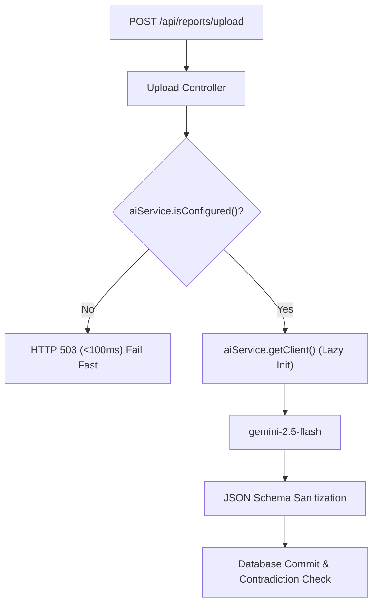

# MediTrack V3.1 — AI Engine & OCR Processing Manual

This manual details the architecture and operational behavior of the Google Gemini AI integration in **MediTrack V3.1**.

---

## 1. Overview & Capabilities

MediTrack leverages the official Google GenAI SDK (`@google/genai`) and the `gemini-2.5-flash` model to analyze unstructured medical documents, laboratory summaries, and pathology reports.

### Key Capabilities
- **Multimodal Document Processing**: Directly processes PDF files, JPGs, and PNGs without external Tesseract/OCR binaries.
- **Biomarker Standardization**: Maps lab-specific terminology (e.g., "HbA1c", "Glycated Hemoglobin", "A1C") to standardized clinical biomarker keys.
- **Structured JSON Output**: Uses schema-enforced prompt formatting to guarantee structured output parseable by the backend.
- **Zero-Crash Lazy Initialization**: The SDK client is not instantiated during server boot, eliminating unhandled exceptions or noisy warnings when credentials have not been configured.

---

## 2. Architecture & Service Pattern

The AI engine is centralized in [`backend/services/ai.service.ts`](file:///d:/meditrack-v2.0/Meditrack%20V3.1/backend/services/ai.service.ts).



### Fail-Fast Circuit Breaker
In earlier iterations, uploading without a configured `GEMINI_API_KEY` triggered repeated retries with exponential backoff, causing the client request to hang for over 30 seconds before failing with an unhandled 500 error.

The current `aiService`:
1. Checks whether `process.env.GEMINI_API_KEY` exists before attempting any network call.
2. Returns an immediate HTTP 503 with a structured error payload:
   ```json
   {
     "error": "AI service is currently not configured. Set GEMINI_API_KEY in server environment.",
     "code": "AI_UNCONFIGURED"
   }
   ```
3. Classifies transient errors (e.g., rate limits, HTTP 429) versus permanent authentication errors (HTTP 401/403) so users receive actionable feedback.

---

## 3. Extraction Schema & Prompt Engineering

The system prompt instructs Gemini to act as an authoritative medical pathology data extractor:

```text
You are an expert medical lab report parser. Analyze the uploaded document and extract clinical measurements and report metadata.
Return ONLY valid JSON matching this schema:
{
  "title": string,
  "report_date": "YYYY-MM-DD",
  "category": string,
  "parameters": [
    {
      "parameter_name": string,
      "value": string,
      "numeric_value": number | null,
      "unit": string,
      "reference_range": string | null,
      "flag": "NORMAL" | "HIGH" | "LOW" | "CRITICAL" | null
    }
  ]
}
```

---

## 4. Diagnostics & Monitoring

### Health Endpoint
The server exposes an unauthenticated health probe at `GET /api/ai/health`:

- **When Key is Configured**:
  ```json
  {
    "status": "CONFIGURED",
    "provider": "Google Gemini",
    "model": "gemini-2.5-flash",
    "message": "Gemini AI integration is active and configured."
  }
  ```

- **When Key is Missing**:
  ```json
  {
    "status": "NOT_CONFIGURED",
    "provider": "Google Gemini",
    "model": "gemini-2.5-flash",
    "message": "GEMINI_API_KEY is not configured in the environment."
  }
  ```

---

## 5. Privacy & Security

- **No Secret Leaks**: The API key is strictly read from `process.env.GEMINI_API_KEY` and never returned in diagnostic endpoints, logged to console, or passed to client bundles.
- **Upload Isolation**: Files stored in `./uploads/` are isolated per user with randomized cryptographic prefixes.
