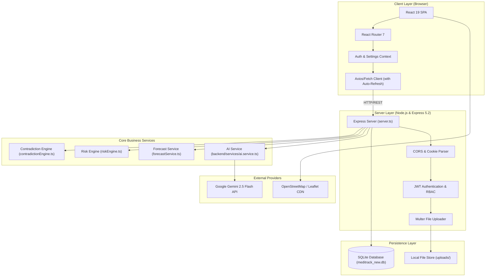

# MediTrack V3.1 — System Architecture

This document describes the high-level and detailed architecture of **MediTrack V3.1**, detailing client-side state management, the Express backend routing layer, database schema designs, and the AI OCR pipeline.

---

## 1. High-Level Architecture Overview

MediTrack is structured as a unified, high-performance web application consisting of a single Node.js runtime process that serves both the compiled React 19 Single Page Application (SPA) and the RESTful clinical API.

---

## 2. Frontend Architecture (React 19 + Vite)

### Component Hierarchy & Layout
- **Routing**: Handled via `react-router-dom` v7 with nested route definitions in [`src/App.tsx`](file:///d:/meditrack-v2.0/Meditrack%20V3.1/src/App.tsx).
- **Protected Boundaries**:
  - `ProtectedRoute`: Verifies active session token; redirects unauthenticated visitors to `/login`.
  - `AdminRoute`: Verifies `user.role === 'ADMIN'`; restricts administrative management modules.
- **State Management**:
  - `AuthContext`: Manages access tokens in memory, session state, user roles, and silent refresh triggers.
  - `SettingsContext`: Manages user display preferences, dark/light themes, and metric unit selections.
- **Client API Interceptor (`src/api/client.ts`)**:
  - Automatically attaches `Authorization: Bearer <token>` to requests.
  - Intercepts `401 Unauthorized` responses and silently performs token refresh via `/api/auth/refresh`.
  - Features an asynchronous queue that serializes concurrent requests during active refresh cycles and releases subscribers immediately upon resolution or failure.

---

## 3. Backend Architecture (Express 5.2)

### Middleware Pipeline
1. **Security Headers & CORS**:
   - Explicit whitelist origin check supporting `localhost:3000`, `localhost:5173`, and production domains.
   - `credentials: true` enables HTTP-only cookie exchange for refresh tokens.
2. **Body Parsing**:
   - `express.json({ limit: '10mb' })`
   - `express.urlencoded({ extended: true, limit: '10mb' })`
   - `cookieParser()` for secure cookie extraction.
3. **Authentication & RBAC Middleware**:
   - `authenticateToken`: Validates Bearer JWTs and populates `req.user`.
   - `requireAdmin`: Enforces administrative permissions.
4. **Rate Limiting**:
   - In-memory sliding window counters preventing brute-force authentication and upload abuse.

---

## 4. Database Architecture (SQLite)

The database engine utilizes SQLite via `@libsql/client` or `better-sqlite3` targeting [`meditrack_new.db`](file:///d:/meditrack-v2.0/Meditrack%20V3.1/meditrack_new.db).

### Core Tables

#### `users`
| Column | Type | Constraints | Description |
| :--- | :--- | :--- | :--- |
| `id` | INTEGER | PRIMARY KEY AUTOINCREMENT | Unique user identifier |
| `email` | TEXT | UNIQUE, NOT NULL | Account email address |
| `password_hash` | TEXT | NOT NULL | Bcrypt hashed password |
| `role` | TEXT | DEFAULT 'PATIENT' | Role: 'PATIENT' or 'ADMIN' |
| `created_at` | DATETIME | DEFAULT CURRENT_TIMESTAMP | Registration timestamp |

#### `reports`
| Column | Type | Constraints | Description |
| :--- | :--- | :--- | :--- |
| `id` | INTEGER | PRIMARY KEY AUTOINCREMENT | Unique report identifier |
| `user_id` | INTEGER | FOREIGN KEY (`users.id`) | Owning patient ID |
| `title` | TEXT | NOT NULL | Original document title |
| `file_path` | TEXT | NOT NULL | Path on disk in `./uploads/` |
| `file_hash` | TEXT | NOT NULL | SHA-256 content hash for deduplication |
| `report_date`| TEXT | NOT NULL | Clinical date extracted from report |
| `category` | TEXT | DEFAULT 'General' | Report classification |
| `raw_text` | TEXT | NULL | Extracted text content |
| `created_at` | DATETIME | DEFAULT CURRENT_TIMESTAMP | Ingestion timestamp |

#### `measurements`
| Column | Type | Constraints | Description |
| :--- | :--- | :--- | :--- |
| `id` | INTEGER | PRIMARY KEY AUTOINCREMENT | Unique record identifier |
| `report_id` | INTEGER | FOREIGN KEY (`reports.id`) | Source clinical document |
| `parameter_name` | TEXT | NOT NULL | Standardized biomarker name |
| `normalized_value` | REAL | NOT NULL | Numeric parsed measurement value |
| `unit` | TEXT | NOT NULL | Unit of measure (mg/dL, mmHg, etc.) |
| `reference_range` | TEXT | NULL | Clinical normal reference window |
| `flag` | TEXT | NULL | 'NORMAL', 'HIGH', 'LOW', 'CRITICAL' |
| `measurement_date` | TEXT | NOT NULL | Date biomarker was recorded |

#### `contradictions`
| Column | Type | Constraints | Description |
| :--- | :--- | :--- | :--- |
| `id` | INTEGER | PRIMARY KEY AUTOINCREMENT | Conflict record identifier |
| `user_id` | INTEGER | FOREIGN KEY (`users.id`) | Associated patient |
| `parameter_name` | TEXT | NOT NULL | Biomarker with discrepancy |
| `report_id_a` | INTEGER | FOREIGN KEY (`reports.id`) | First conflicting report |
| `report_id_b` | INTEGER | FOREIGN KEY (`reports.id`) | Second conflicting report |
| `value_a` | TEXT | NOT NULL | Measurement value A |
| `value_b` | TEXT | NOT NULL | Measurement value B |
| `severity` | TEXT | NOT NULL | 'LOW', 'MEDIUM', 'HIGH', 'CRITICAL' |
| `explanation` | TEXT | NOT NULL | Clinical description of the conflict |
| `created_at` | DATETIME | DEFAULT CURRENT_TIMESTAMP | Detection timestamp |

---

## 5. AI Extraction Pipeline

1. **File Ingestion**: User uploads a file via `POST /api/reports/upload`.
2. **Deduplication Check**: Computes SHA-256 hash. If duplicate is detected for the user, existing records are returned.
3. **AI Provider Verification**: Queries `aiService.isConfigured()`. If unconfigured, fails fast (<100ms) with `503 Service Unavailable`.
4. **Gemini Extraction**: Converts buffer to base64, attaches system prompt requiring structured JSON output, and requests extraction from `gemini-2.5-flash`.
5. **Database Transaction**: Atomic commit writes report metadata and measurement records into SQLite.
6. **Contradiction Evaluation**: Triggers `contradictionEngine.evaluateUserContradictions(userId)` to detect conflicts against previous reports.
